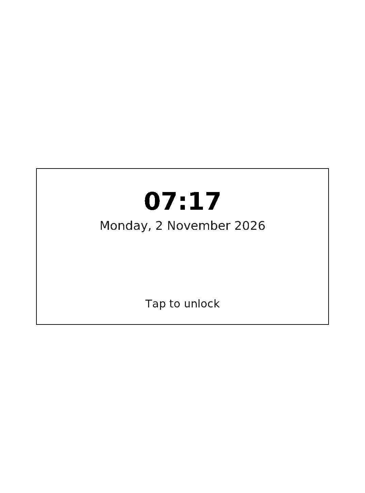
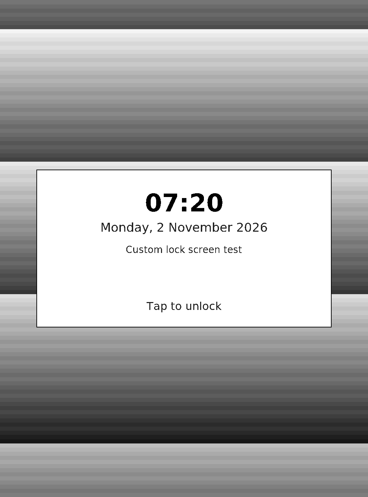

# Lock screen customisation — PW3 trial (2026-11-02)

Status: **partial device acceptance.** The new shell is deployed and the lock
screen renders with and without a raw image. The KOReader plugin is installed,
but its menu export has not been exercised on the device.

## Deployed build

| Item | Value |
| --- | --- |
| Boot ID | `2863e424-eb90-4077-90c6-897a2c9dd9af` |
| `gw-shell` | `ebb637a4bdcd419b6bdd2fc61c21b99c9f700faeaaa8fd66a55e39989946ff98` |
| Rollback shell | `/usr/sbin/gw-shell.before-lockscreen-20261102` = `ecb8f560f415425d59ee40aee5a74234412d30b1167d0954edc4ab76564387f9` |
| Plugin | `opt/koreader/plugins/gw-lockscreen.koplugin` (`main.lua` `961014a4…`, `_meta.lua` `4b1fe273…`) |
| Deployment | direct binary/plugin update over the USB console; no bootloader, kernel or partition write |

## Results

| Check | Result |
| --- | --- |
| Home screen after reboot | **PASS** |
| `gwctl lock` event reaches the shell | **PASS** (`event POWER LOCK`, `paint profile=lock`) |
| Default lock screen (clock, date, tap) | **PASS**, see below |
| Raw image + message overlay | **PASS**, see below |
| Config `use_image=0` returns to text-only | **PASS** |
| Rollback binary present | **PASS** |





## Defect found and fixed during acceptance

The first deployed shell froze after painting Home because `gw_hub.c` created
the hub listen socket without `SOCK_NONBLOCK`; the 50 ms hub timer then blocked
in `accept4()` with no agent connected. The fix adds `SOCK_NONBLOCK` to the
listen socket. The final `ebb637a4…` build includes it.

The lock transition also initially read `/mnt/us` on the lock path, which could
race the service's display-off. Config and image are now loaded at startup and
by a background mtime poll; the lock path only refreshes labels.

## Not proven

- KOReader menu → **Use current sleep screen** export on hardware.
- The exported raw matches the KOReader sleep screen (scale, rotation, dither).
- Physical power-button lock; the test used `gwctl lock`, which broadcasts the
  same `POWER LOCK` event.
- Suspend/resume with an image.
- Removing the config while the shell runs (code fixed; not re-tested after the
  final build).

## Reproduction

```sh
python3 tools/maintenance/capture-screen.py --output /tmp/lock.png
```

Captures were taken over the physical USB console from `/dev/fb0`. The images
are redacted only in the sense that they contain no private book content.
