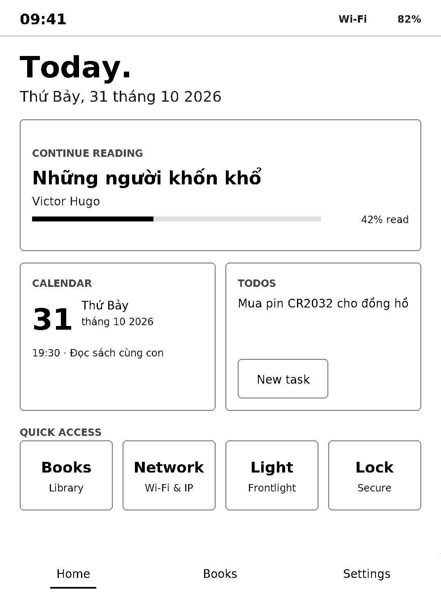
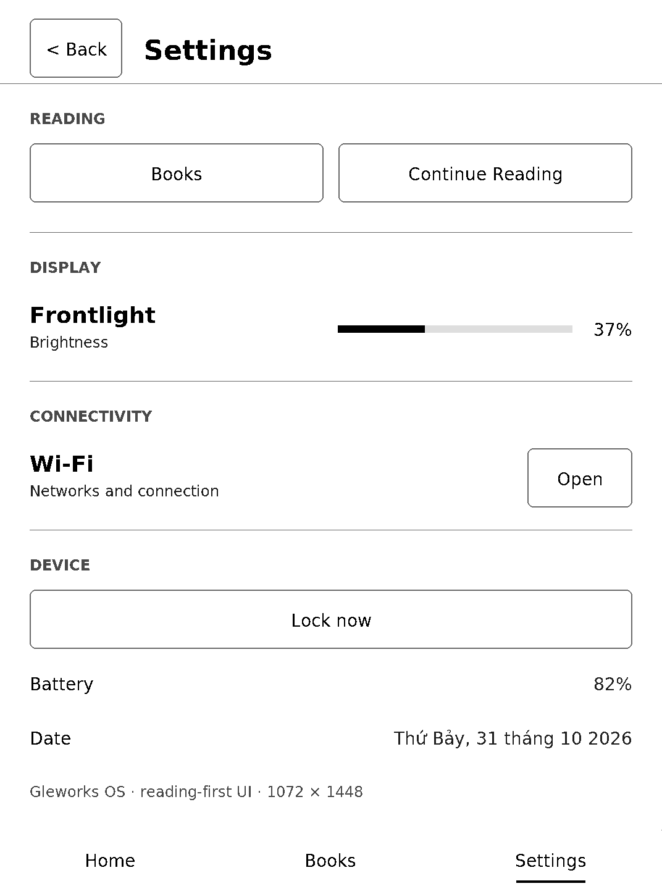
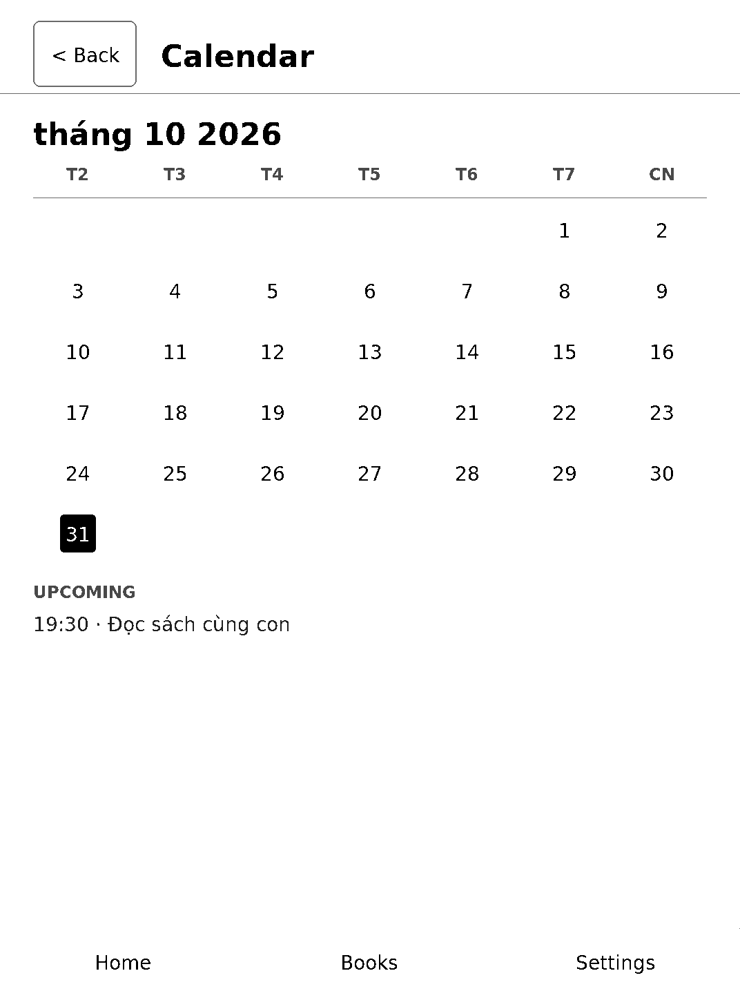
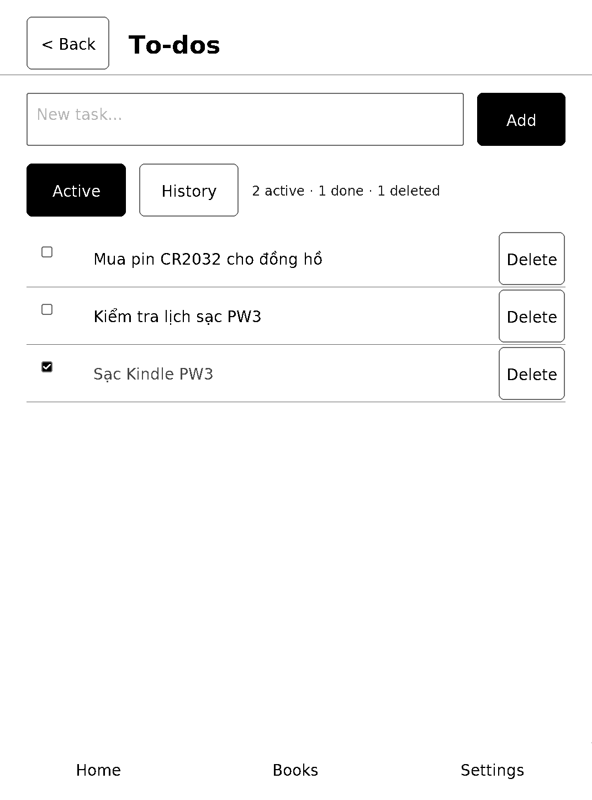
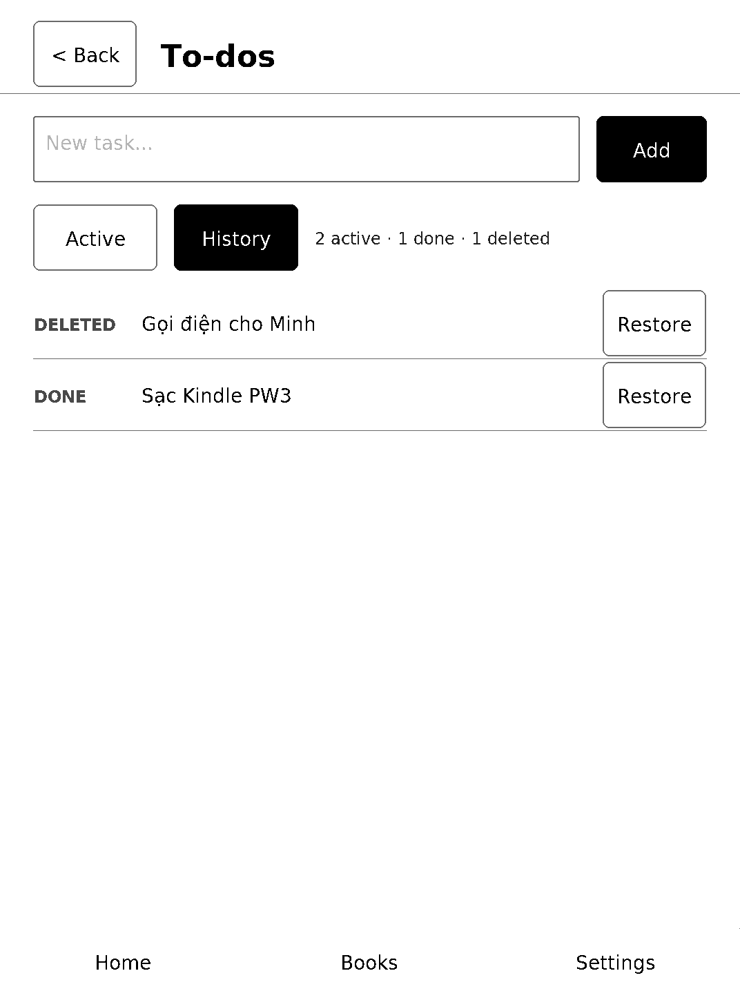
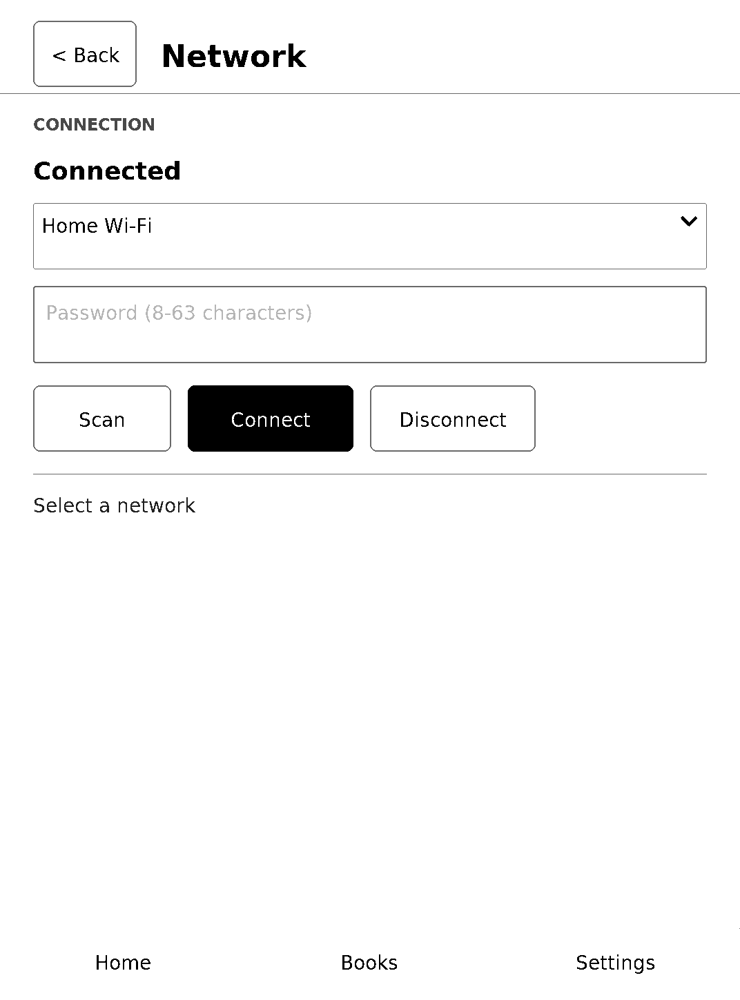
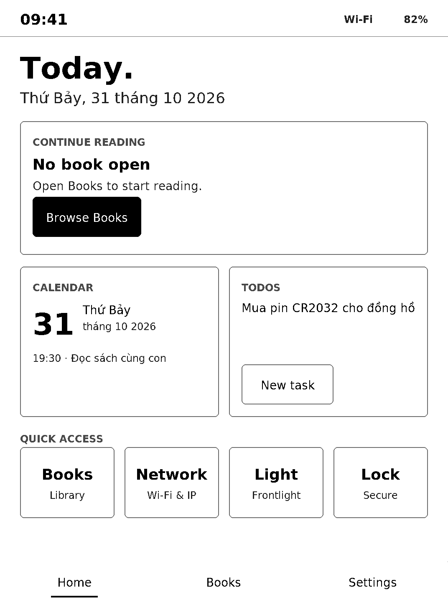
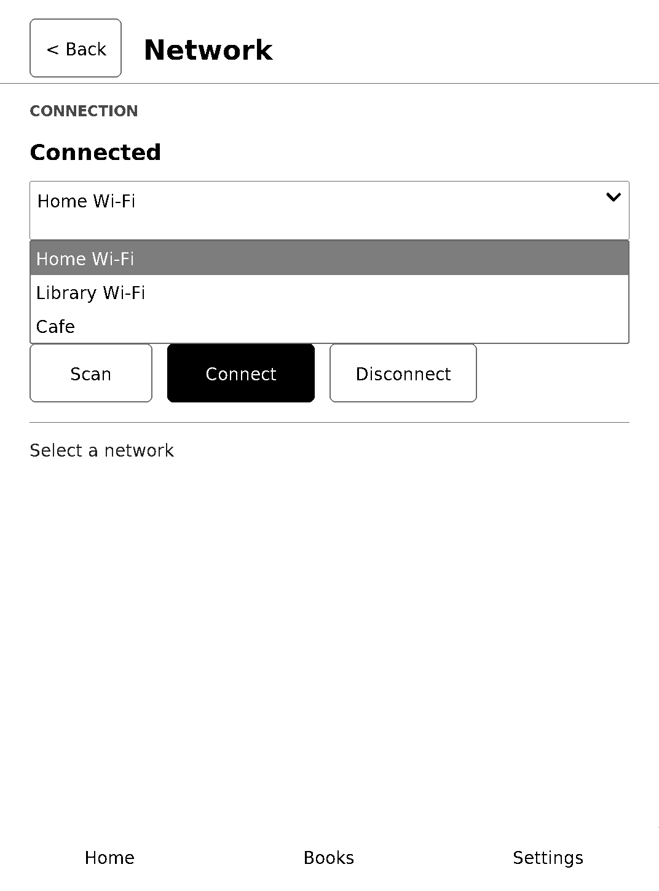

# PW3 Home UI redesign — host evidence

Date: 2026-10-31  
Scope: host-only redesign, preview, geometry tests and ARM/musl compile.  
Device policy: **the physical PW3 was not touched.** No USB, SSH, deployment,
capture, network change, service restart or device telemetry was performed.

See the design specification:
[`docs/technical/PW3-HOME-UI-REDESIGN.md`](../../technical/PW3-HOME-UI-REDESIGN.md).
Keyboard latency work:
[`docs/technical/PW3-TYPING-RESPONSIVENESS.md`](../../technical/PW3-TYPING-RESPONSIVENESS.md).
Shared UI kit and freeze policy:
[`docs/technical/PW3-UI-KIT.md`](../../technical/PW3-UI-KIT.md).

Task closure and final verification: [`CLOSURE.md`](CLOSURE.md).  
Machine-readable session task list: [`TASKS.json`](TASKS.json) — **0 open tasks**.  
Human-readable task list: [`TASKS.md`](TASKS.md).

## 1. What changed

- Rebuilt `os/ui/gw-shell.c` around five persistent screens: Home, Settings,
  Calendar, To-dos and Network, plus the existing lock screen.
- Expanded `os/ui/gw_ui_style.h` with shared geometry, colour, typography and
  component styles.
- Added Vietnamese-capable LVGL fonts in `os/ui/fonts/` and `gw_fonts.h`.
- Added a real host LVGL simulator in `os/ui/host_sim.c` using the same widget
  code and the pinned LVGL 8.3.11 source.
- Added `GW_UI_HOST_SIM` to the display/input ports: renders into a plain
  memory framebuffer, never opens `/dev/fb0`, evdev or the gw-system socket.
- Added reproducible scripts:
  - `os/ui/sim/run-preview.sh` — build, render, geometry checks, PNG export.
  - `os/ui/build-arm.sh` — host-side ARM/musl build; no deployment.
- Reworked virtual-keyboard text entry: no delayed password reveal, no cursor
  blink, no pressed-key inversion, DU fast partial updates for focused text
  entry, and press/release coalescing. See section 5.

No changes were made to `gw-system.c`, network helpers, boot scripts, Guardian,
power lifecycle or filesystem behaviour.

## 2. Host simulator

The simulator compiles `host_sim.c`, which includes the real `gw-shell.c`, plus
the project-pinned `work/sources/lvgl` 8.3.11 tree and the checked-in fonts.
The display port is replaced with a 1072 × 1448 grayscale memory framebuffer.
All screenshots below are actual LVGL renders from that path, not substitute
images. The host clock is fixed at Saturday, 31 October 2026, 09:41 so the
rendered output and hashes are deterministic; device builds still use
`localtime()`.

Reproduce:

```sh
./os/ui/sim/run-preview.sh
```

Result from this run:

```text
lvgl heap: total=262144 used=117296 max_used=47187 free=144848 used_pct=45% frag=1%
geometry checks: 633 total, 0 failed
screenshots: /tmp/opencode/gw-ui-preview/{home,settings,calendar,todos,network}.ppm
Preview written to docs/evidence/pw3-ui-redesign-2026-10-31/screenshots (1072x1448 each)
```

The simulator does not require `/dev/fb0`, `/dev/input/event*`, root, a running
`gw-system`, a network connection or a Kindle.

## 3. Screenshots

All files are exactly **1072 × 1448**, 8-bit grayscale PNG.

### Home



### Settings



### Calendar



### To-dos



### To-dos history



### Network



### Home — device empty state



### Network dropdown popup



SHA-256:

```text
d003869cd0721be5c0c6c8f168447edb722e1650e318190c59e278414b9621fe  calendar.png
0a063b9385275a5ed271ba181d811744e62c5a13c8dc1c7f09dc7df44cbb7e81  home.png
dd41508b1c3b49aafbc40f7d70e97fff7e90f04c6f0850bbe152e73fa28317e2  home-empty.png
53b4684ffe45232aab8e6288c110bbedd0c1d04903526255e7b285cffeca0180  network.png
ea8f4449fcc0b2e2717e61450b1672024f0987bb9aabf602c762c50669d39134  todos.png
726776e519d7de4821096a37956feb294549131ebd939be0e8d6e693f1dbb6c4  todos-history.png
36d387554c9a5b644687fe57f50da29b399be67718d52c17c747f57967279ef6  settings.png
30f618e01e2af2bbd041789fd4e3ffffd2b80f21de1dd6febb0ea91b1a4a7ad3  network-popup.png
```

## 4. Geometry and navigation checks

Machine-readable report: [`geometry.json`](geometry.json).  
Result: **633 checks, 0 failures.**

| Screen | Checks |
|---|---:|
| Home | 112 |
| Home empty state | 88 |
| Settings | 86 |
| Calendar | 159 |
| To-dos | 78 |
| Network | 59 |
| Network popup | 51 |

Check families:

- `inside_screen` — every visible object stays inside 0..1071 × 0..1447.
- `label_not_clipped` — measured text fit or explicit ellipsis/clip mode with a
  usable line height.
- `touch_min_96` — every button, slider, textarea, dropdown and keyboard
  control is at least 96 × 96 px.
- `content_below_appbar` / `content_above_nav` — secondary screens do not
  overlap the app bar or bottom navigation.
- Home section order and non-overlap:
  status → hero → Continue Reading → widget row → Quick Access → bottom nav.
- Equal widget widths, equal quick-action widths, 24 px shortcut gaps, and
  48 px left/right margins.
- `navigation_transition` — all five screens load the expected LVGL screen.
- `widget_callback` — the exact callbacks attached to Settings, Calendar,
  To-dos, Network and Home widgets switch to the expected screen.
- `empty_reading_state`, `empty_reading_text`, `populated_reading_state` —
  Continue Reading empty/populated transitions, including a full object-tree
  clipping/touch pass over the rendered empty card.
- `empty_tasks_state` — explicit `No tasks yet.` state.
- `store_add`, `store_complete`, `store_reopen`, `store_delete`, `store_restore` — TODO state transitions.
- `history_view` — completed/deleted history rows build correctly.
- `scan_loading_result` — mock scan result populates the dropdown.
- `network-popup` — 51 additional checks over the open dropdown popup,
  including bounds, touch targets and label clipping.
- `password_no_delayed_reveal` — password characters hide immediately
  (`pwd_show_time = 0`).
- `password_cursor_no_blink`, `todos_cursor_no_blink` — cursor animation time
  is zero.
- `keyboard_no_press_inversion` — pressed keys have no dark colour filter.
- `typing_fast_mode_enabled` — text entry uses the DU fast path with deferred
  GC16 cleanup.
- `reader_callback_host_safe` — the host preview does not exit on launch.

Manual review of the rendered PNGs confirmed:

- Vietnamese glyphs render correctly: `Những người khốn khổ`,
  `Thứ Bảy`, `tháng 10`, `Đọc sách cùng con`.
- No label overflow or card collision.
- Dropdown arrow renders correctly with the indicator font.
- Frontlight control exposes a 380 × 96 touch region over a thin 12 px track.

## 5. Keyboard typing responsiveness

The Wi-Fi password field now uses an E-ink-specific typing path:

- password characters hide immediately instead of being revealed for 1.5 s;
- the text cursor does not blink;
- a pressed key inverts to black with white text, so the user sees exactly
  which key was pressed;
- the key highlight uses `WAVEFORM_MODE_A2` on its own small region, matching
  KOReader's keyboard-highlight approach;
- each key press/release refreshes **only that key's small area** with A2 and
  is submitted before text-field updates; distant keys are never merged into a
  keyboard-sized rectangle;
- during an active key burst the text field is re-queued; it catches up after
  input pauses;
- keyboard/popup dismissal no longer triggers a full-screen GC16; a 500 ms
  partial-only guard prevents input transitions from flashing the panel;
- the password caret bar is hidden; the key highlight is the feedback;
- touch press/release frames are processed one per render cycle, so the pressed
  key is actually drawn instead of being overwritten in the same cycle;
- the text field gets a localized REAGL full cleanup after a 350 ms typing
  pause, removing DU ghosting without a full-screen flash;
- keyboard and popup dismissal no longer schedule a full-screen GC16; only
  screen transitions do;
- the text field uses `WAVEFORM_MODE_DU` as a separate region, throttled to one
  update per ~120 ms while typing so it cannot queue ahead of key feedback;
- distant dirty rectangles are no longer merged into one screen-sized bounding
  box, which previously promoted every key to a full GC16 flash;
- dropdown/menu popups use their own DU partial region and are excluded from
  full-screen area promotion;
- there is no typing debounce: press feedback is sent immediately;
- one full GC16 cleanup runs after keyboard dismissal, leaving the text screen,
  only after the keyboard is dismissed or the text screen is left — never while
the keyboard is focused, so a thinking pause cannot trigger a flash.

Device diagnostic evidence (12 synthetic key/text updates after the keyboard was
open):

```text
epdc submit waveform=1 area=64990  fast=1   # text field, DU
epdc submit waveform=4 area=12075  fast=1   # key highlight, A2
...
```

Only the initial screen load used a full GC16. No per-key full-screen flash was
observed in the update stream.

Source review is documented in
[`docs/technical/PW3-TYPING-RESPONSIVENESS.md`](../../technical/PW3-TYPING-RESPONSIVENESS.md).
Physical latency and ghosting measurements are still pending.

## 6. Shared UI kit and visibility

The final build uses `os/ui/gw_ui_kit.c/.h`; page code composes kit primitives
instead of repeating styles. The migration is pixel-identical to the previous
render baseline for Home, Settings, Calendar, To-dos, Network, Home empty,
To-dos history and Network popup.

Contrast is raised through `theme/tokens.json`:

```text
text      #0A0A0A
secondary #303030
muted     #404040
border    #707070
card      #EEEEEE
```

Section labels use bold 24 px text; cards, secondary buttons, text areas and
popup lists use 2 px borders. No layout coordinates changed.

## 7. To-do storage

To-dos are stored atomically in `/var/lib/gleworks/todos.tsv`:

```text
id <TAB> status <TAB> created <TAB> updated <TAB> text
status: 0 active, 1 done, 2 deleted
```

Limits: 64 tasks, 160 bytes per task. Save uses a temp file, fsync and rename.
There is no SQLite dependency; the ARM binary remains static musl.

## 8. ARM/musl artifact

Reproduce without deploying:

```sh
./os/ui/build-arm.sh
```

Artifact:

```text
Path:   os/ui/gw-shell
Size:   2,618,360 bytes
Class:  ELF32, ARM, static (no dynamic section)
SHA256: 8b8ac88191b8f4bf3960345d7b3d433d3f95a0dc7276714789b1a813d51e5020
Flags:  GW_UI_LIFECYCLE_SPIKE=1
        GW_UI_EPDC_SPIKE=1
        GW_UI_TOUCH_SPIKE=1
        GW_UI_EPDC_ACCEPTED=0
        GW_UI_TOUCH_ACCEPTED=0
        GW_UI_PERF=0
        GW_UI_DIAG=0
        GW_UI_EINK_FAST_MODE=1
        LV_MEM_SIZE=262144
```

Toolchain:

- `work/toolchains/toolchain-gcc-4.9.4/gcc-4.9.4-nolibc/arm-linux-gnueabi`
- musl prefix `work/toolchains/musl-arm-prefix`
- Linux headers `linux-headers-6.18.7`
- LVGL `work/sources/lvgl` (8.3.11)
- Flags: `-Os -marm -march=armv7-a -mfloat-abi=soft`, static musl

The artifact remains on the host only. It was not copied, uploaded, booted or
installed during this work.

## 9. Performance risk analysis

| Area | Result / risk |
|---|---|
| Idle input/render | Event-driven loop unchanged; status timer is still 30 s. Clock/date labels update only when the displayed value changes. |
| EPDC idle work | Static Home invalidates nothing; partial dirty rectangles and waveform selection are unchanged. No full rebuild per status update. |
| KOReader foreground | Launch still exits the shell through the existing reader path, so Home generates no EPDC work while KOReader is foreground. |
| Memory | LVGL pool raised 48 KiB → 256 KiB. Host peak after building all five screens: 119,192 bytes (46 %, 1 % fragmentation). Adds ~208 KiB static pool on a 512 MiB device. |
| Binary size | 427 KiB → 2.2 MiB because six 4 bpp Vietnamese fonts are embedded. Read-only text mapping; no additional heap. |
| Screen switches | One full-screen E-ink repaint per switch is expected (GC16); steady state remains quiet. |
| Status polling | One bounded IPC request per 30 s, same as the previous shell; Wi-Fi scan is the only immediate poll. |
| Logging | Production `GW_UI_PERF=0`, `GW_UI_DIAG=0`; no new high-frequency logging. |
| Typing waveform | Key highlights use A2, text changes use DU, each on its own small region; one deferred GC16 cleanup follows. Ghosting after long entry still needs human review. |
| Typing regions | Distant dirty rectangles remain separate. A key is ~12k px, the field ~65k px; no full-screen promotion per key. To-dos list stays above the keyboard. |
| Unknown risk | Physical EPDC latency/ghosting and touch calibration are not measured in this work and remain gated by the device checklist below. |

## 10. Related issues found during the audit

| Issue | Status |
|---|---|
| Per-key full-screen GC16 caused by one merged dirty bounding box | **Fixed** — separate A2 key / DU text regions |
| No visible key-press feedback | **Fixed** — pressed key inverts to black/white |
| Keyboard special keys showed missing-glyph boxes | **Fixed** — LVGL symbol glyphs merged into the fonts |
| To-dos list/keyboard overlap | **Fixed** — list scrolls under a separate input row |
| Hidden keyboard could remain visible when returning to To-dos/Network | **Fixed** — screen changes dismiss both keyboards and reset the typing state |
| Delayed password reveal (1.5 s) and cursor blink | **Fixed** — password show time 0, cursor anim time 0 |
| Diagnostic `send()` / `GW_UI_PERF` compile errors | **Fixed** (diagnostic builds only) |
| Wi-Fi association after the saved AP disappeared | **Resolved** — connected to `Will`, IP `192.168.1.200`, `wifi-state=CONNECTED`, Tailscale peer online. The old saved AP was no longer in range. |
| Long DU/A2 typing sessions may leave ghosting until dismissal | **Mitigated by policy** — cleanup runs on keyboard dismissal/screen change; no flash during typing. Human visual check remains. |
| Sticky EPDC error after an ioctl failure | **Fixed** — failures are retried on the next update with a 5 s log backoff |
| Space key has no visible label | **Closed as standard LVGL behavior** — the button text is also the inserted character, so labelling it “space” would insert literal text. Left blank intentionally. |
| Fast typing could let text-field updates queue ahead of key feedback | **Fixed** — A2 key highlights are prioritized; DU text is throttled |
| Press + release produced two key animation frames per character | **Fixed** — frame splitting ensures the press is drawn; each key area is refreshed independently |
| Dropdown popup flickered / used slow redraw | **Fixed** — styled popup, own DU region, no full-area promotion while open |
| Whole keyboard flashed on fast typing | **Fixed** — no union of far-apart keys into a keyboard-sized A2 region |
| Whole screen flashed occasionally during input | **Fixed** — keyboard/popup dismissal no longer requests full-screen GC16, with a 500 ms partial-only guard |
| Input frame was overwritten before display | **Fixed** — one touch frame per render cycle |
| Input transition could be promoted to full screen | **Fixed** — screen transitions clear the partial-only guard, input transitions do not use it |
| Popup and keyboard-dismiss frame could combine into a full flash | **Fixed** — popup-open frames never use area promotion and all use DU |
| Flashing caret bar in the password field | **Removed** — password cursor background/border hidden |
| Fast typing showed no key animation at all | **Fixed** — touch frames are processed one per render cycle, so press is drawn before release |
| Ghosting in the input shell | **Mitigated** — localized REAGL cleanup for the text field after a 350 ms pause |

## 11. Manual hardware checks (out of scope)

These are **not open software tasks**. They are recorded as `out-of-scope` in
[`TASKS.json`](TASKS.json) because they require a human and a controlled
physical test, not code changes. The software task list has **0 open tasks**.

- [ ] Confirm battery measurement session has ended and the device is free.
- [ ] Back up the current `/usr/sbin/gw-shell` before deployment.
- [ ] Deploy the artifact separately and verify its SHA-256 on device.
- [ ] Confirm `gw-shell` starts under `gw-system --supervise` with no reboot loop.
- [ ] Capture a full-panel framebuffer image and compare composition with
      `screenshots/home.png`.
- [ ] Verify all Vietnamese strings render without missing glyph boxes.
- [ ] Verify status bar refresh does not cause visible whole-screen flashing.
- [ ] Measure idle CPU and EPDC update count; compare with the 0.10 % / ~1/min
      baseline.
- [ ] Tap every control and confirm ≥96 px targets and correct screen changes:
      Books, Network, Light, Lock, Calendar card, To-dos card, bottom nav.
- [ ] Verify Continue Reading empty state on device (metadata provider still
      absent); `Browse Books` launches KOReader.
- [ ] Verify To-dos add/check/delete/history survive a shell restart.
- [ ] Verify Network scan, connect, disconnect and password keyboard.
- [ ] Time a 12-character password entry; compare against the reported ≥15 s.
- [ ] Confirm no password character is briefly shown in clear text.
- [ ] Confirm no cursor blink while the password/To-dos field is focused.
- [ ] Confirm the pressed key visibly inverts so the typed key is identifiable.
- [ ] Measure touch-to-visible latency for 20 keys (median/P95) and EPDC update
      count per 10 keys.
- [ ] Check DU ghosting after 12–20 characters, before and after the deferred
      GC16 cleanup.
- [ ] Confirm pausing between characters does not trigger a mid-typing GC16
      flash; cleanup must wait for keyboard dismissal or screen change.
- [ ] Confirm To-dos list remains usable with the keyboard open and history rows are readable.
- [ ] Confirm keyboard special keys render (backspace, enter, arrows, check,
      keyboard) rather than missing-glyph boxes.
- [ ] Repeat the typing check in the To-dos input.
- [ ] Verify Settings frontlight changes the panel and reports the value.
- [ ] Verify Lock/Unlock and return-to-Home from KOReader.
- [ ] Verify KOReader foreground produces no Home EPDC updates.
- [ ] Record human visual acceptance in bright and low light.
- [ ] Only then mark physical PW3 UI acceptance PASS.

Until these items are complete, the physical UI acceptance result is
**PENDING**, not PASS.
